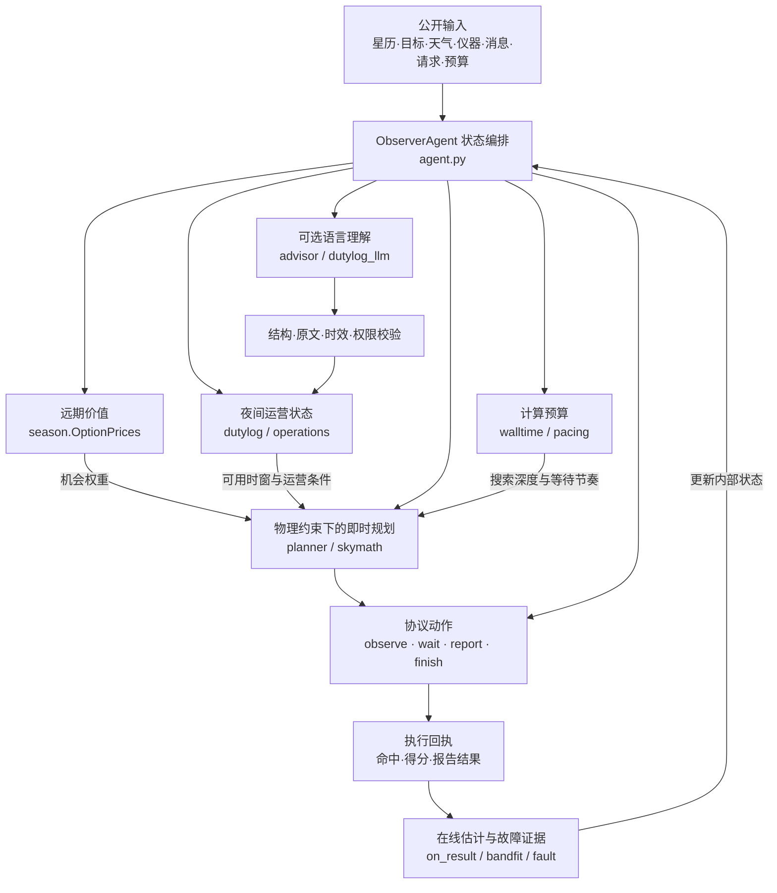

# 观天识时，择机而动
## 从天文观测智慧到自主智能体设计

**The Sky Is Not a Queue**  
*An Astronomy-Inspired, Evidence-Grounded Autonomous Observer*  
**实现版本：** Runner 15（具体代码与运行开关以随附原始 ZIP 及 `observer.project.json` 为准）

> **天文学探索如何从有限的观测中建立对宇宙的可靠认识；Agent 工程探索如何在不完备的信息与动态变化的环境中，实现自主而可信的决策。** 两者看似分别关乎认识与行动，却共享着相似的方法论：尊重客观约束、显式处理不确定性、依靠证据修正判断，并通过持续反馈提升系统的可靠性。
我们尝试将这种共通的方法论转化为具体的工程架构：以物理模型限定可行域，以优化算法分配有限资源，以语言模型理解非结构化信息，以观测反馈校正决策。
在这里，天文学不只是 Agent 的应用场景，也是其设计原则的来源。

### 项目摘要

天空不是一个按顺序等待执行的任务队列。地球自转与季节变化决定了观测窗口，月光和大气改变信号质量，焦面上的光纤几何限制了一次曝光能够获得的数据。某个目标即使价值很高，也未必值得现在观测；一条自然语言公告即使看似可信，也不足以直接授权停机或报修。

DESI、PFS 等现代巡天已建立高水平的自动选场、观测规划、光纤配置与质量反馈体系。我们并不试图用 LLM 重造这些成熟的专业算法，而是探索下一层工程问题：**当目标的长期价值、临时运营信息和实时执行状态同时变化时，如何将可靠的局部自动化组织为可信的整体自主性？**

我们据此构建了一个**分层规划、闭环校准、证据约束、预算自适应**的自主观测 Agent。观测季层估计未来供需和机会成本，将长期稀缺性压缩为短期决策可使用的价值权重；曝光层把指向、光纤分配、曝光时长和程序作为相互耦合的行动，在天球几何、天气和运维约束下求解；反馈层用真实命中与质量回执修正效率、指向和故障证据；语言模型则作为非结构化信息的解释接口，输出必须经过结构、时效和来源校验，不能绕过确定性决策链；计算预算层根据剩余资源调整搜索深度，必要时有意识地等待。**长期价值的计算主要由优化器承担；LLM 负责补充语言理解，而不替代物理与数学决策。**

各个模块拥有**清晰而有限的责任**：物理定义可能，规划决定值得，观测检验判断，证据约束权限。系统追求的不是没有边界的“聪明”，而是**有约束、可反馈、可追溯的自主性**。

---

## 一、设计命题：从天文学的时间观，到 Agent 的控制结构

传统任务调度常假定工作项可以排队：当前任务未完成，下一轮继续尝试。然而巡天中的“时间”并非均匀的容器。目标随地球自转改变高度角，月光与天气改变有效曝光效率，一个天区本季失去的窗口不一定能由下一个夜晚补偿。**时间不仅决定何时行动，也决定行动本身的价值。**

这引出一个比“下一步选什么”更基础的系统问题：在信息持续到达、资源不断消耗的环境里，怎样让 Agent 的每次局部行动不偏离长期科学目标？我们没有把全部复杂性塞入一个巨大的提示词或一次性优化，而是采用**分层决策（hierarchical decision-making）与滚动重规划（receding-horizon planning）**的思路：远期层评价机会，近期层作出完整动作，执行回执反过来修正下一次判断。这里的“滚动”描述每回合更新决策的工程机制，并不宣称实现了具有最优性保证的模型预测控制。

### 1.1 当观测已经高度自动化，为什么还需要 Agent？

答案首先不是“传统自动化不够智能”。DESI 已经把下午规划、夜间自动选场、动态曝光完成度估计、次日质量检查与目标列表更新接成可靠的业务闭环；PFS 也将巡天规划、光纤配置、仪器控制和数据系统以明确的职责边界组织起来。这些都是本项目的**工程起点，而非待被推翻的旧方案**。[DESI: Schlafly et al. 2023](https://arxiv.org/abs/2306.06309)；[PFS: Shimono et al. 2016](https://arxiv.org/abs/1608.01163)。

问题发生在更高的**决策协调层（decision orchestration layer）**：当观测机会跨季节变化，临时请求与运维公告不断到达，模型、仪器与计算预算的可信状态又在每次行动后被改写，怎样让不同时间尺度的优化器共享必要信息，却不侵入彼此的职责？这里引入 Agent，是为了构建一个持续维护状态、整合证据、重规划并回收执行反馈的自主控制器，而非给望远镜增加一个会聊天的操作员。

**长期一致性是引入 Agent 的核心动机之一，但不是 LLM 的独有贡献。** 传统巡天本来就有长期规划。我们在 `season.py` 中使用启发式机会定价，把未来可见窗口和供需压力折算为 `planner.py` 可以使用的软权重；它改善的是不同时间尺度的协同表达，既不等价于求得整季全局最优，也尚无独立消融证据证明这一设计的净增益。即使完全关闭语言模型，这条物理规划与反馈控制链仍然成立。

**引入 LLM 的理由则不同：为开放格式的信息提供有边界的语义适配能力。** 值班日志、天气公告、临时更正和模糊叙述很难保证始终符合固定协议；依赖逐条添加规则，维护成本会随输入样式增长。我们让规则先处理确定性的内容，仅在允许且必要时让模型提出结构化解释，再通过原文、时间、权限与版本校验进入运营状态。LLM 不负责求解光纤几何，也没有权力直接签发高成本报告。

所以，这里的新增价值不是“AI 比调度器更会选目标”，而是**将成熟的领域自动化、跨时域的价值协调和非结构化信息理解，以可验证的接口组合为一个自主系统**：让优化器精于计算，让语言模型善于解释，让控制器负责取舍。

整套设计可以概括为四条原则：

1. **以约束塑造行动空间，而不是事后修补非法行动**（constraint-aware action design）。
2. **以契约连接异构能力，而不是让每个模块拥有完整权限**（contract-based composition）。
3. **以观测反馈更新内部估计，而不是假定模型永远正确**（closed-loop estimation）。
4. **把计算、等待和失效路径纳入设计，而不是只优化理想状态**（resource-aware autonomy and graceful degradation）。

工程上的优美往往表现为一种克制：每一层只处理自己能够可靠回答的问题，并向下一层输出足够、但不过量的信息。

## 二、系统架构：三个时间尺度、一条反馈回路、两道约束边界

### 2.1 三个时间尺度

**观测季尺度——机会定价，而非逐夜枚举。** `season.py` 的 `OptionPrices` 综合天区剩余目标价值、恒星时可见性、有限光纤供给与未来时段供需，给出相对机会权重。它不直接决定下一次望远镜指向，而是把“未来还有多少选择”凝练成当前决策能够消费的信号。长期规划因而无需侵入每一次曝光的几何细节。

**观测夜尺度——把外界变化转化为运营约束。** `agent.py` 接收天气通告、限时观测请求与值班信息；`dutylog.py`、`operations.py` 等模块处理可确定的时间窗口和地形信息，模型辅助模块在启用且可用时解释较难解析的非结构化消息。本次运行配置中的 `V7_NIGHTPLAN=on` 指**模型辅助的本夜天气/方位建议**，不是启用 `nightsched.py` 的整夜组合优化。

**单次曝光尺度——在可行域内形成可执行命令。** `planner.py` 联合比较指向、光纤、时长和 `DARK / BRIGHT / BACKUP` 模式。先用便宜的天区价值与可见性代理筛选候选，再做详细几何和收益评价。搜索细节可以因预算收缩，但生成动作必须满足同一套物理与协议条件。

这是一种**快慢变量解耦**：季节层改变价值，夜间层改变可用性，曝光层决定动作。系统不必在每一秒重算整季，也不应让长期最优性的幻想阻碍当下可执行的指令。

### 2.2 一条跨回合的反馈回路



上述图示的是职责与信息流，`report` 实际受 `fault.py` 的独立证据门槛和 `agent.py` 的报告策略约束，并非由曝光规划器直接下达。

Agent 的完整性不取决于是否拥有许多互相对话的“子人格”，而在于它是否能够**跨回合保存状态、生成完整动作、消费真实反馈，并在约束变化时重新决策**。本项目是一个有状态控制器组合多个领域能力模块，而不是把模块名称包装成多 Agent 对话。

### 2.3 两道边界与一个决策契约

**第一道是物理边界。** 天体高度角、地形遮挡、月光、视场、光纤网格、可用曝光时间与运维关闭窗口共同构成可行域。一个数学上收益高的动作，如果光纤无法覆盖目标或者观测窗口不足，就不应作为候选命令。

**第二道是证据边界。** 非结构化信息需要原文支持、有效时间、权威性和撤销状态；故障报告需要持续性或效率区间等观测证据。语言模型可以协助解释，但不能凭措辞的确定性代替数据的确定性。

行动以结构化契约输出，而不是自由文本指令：

```text
Decision := Observe(pointing, assignments, duration, program)
          | Wait(until)
          | Report(reason)
          | Finish
```

这是一种便于理解的接口表示；实际实现使用 `participant-agent-protocol-v4` 的 JSON 消息与 `jsonl-v2` 传输，并非上式对应的静态类型系统。**接口保持简单，是因为复杂性已经在接口之前被消化；输出保持严格，是因为执行者不应替规划器猜测意图。**

---

## 三、五项关键工程设计：天文学知识如何成为系统能力

### 3.1 观天识时｜Hierarchical planning：把未来压缩为当前的机会成本

在天文学中，“现在是否值得观测”不能只由单个目标的当前分数回答。同一科学价值的两片天区，一片可能很快失去本季窗口，另一片还会在未来多个夜晚处于高质量时段。它们的机会成本不同。

`OptionPrices` 用天区分组与未来时段的供需近似，为剩余工作量分配软时间价格，再通过 `mult_now()` 影响实时目标价值。这接近资源分配中**影子价格（shadow-price-like signals）**的思想：不要求下层规划器理解完整未来，只需把未来的资源稀缺性作为决策权重。这里使用的是迭代启发式定价，不声称求解严格的对偶最优解。

这一层体现了系统架构中的一条重要原则：**远期规划提供方向，不越权指定细节。** 未来被压缩成可组合的权重，而不是变成一张注定会被天气打乱的僵硬排班表。这样，长期目标与短期适应性才可以同时存在。

> **工程要点：** 把难以直接求解的长期目标，转化为短期控制器可消费的紧凑状态；减少跨层耦合，保持局部决策的响应速度。

### 3.2 择机而动｜Constraint-first planning：让合法性成为求解前提

多目标光谱巡天具有强耦合的执行结构：改变指向，焦面上可覆盖的目标集合随之改变；改变时长，收益与时间成本同步变化；切换 `DARK / BRIGHT / BACKUP` 模式，同一次曝光的有效性又会不同。望远镜不能先“决定想看什么”，再指望物理设备配合。

项目因此将一次动作视为组合对象：

\[
 a_t=(\text{pointing},\;\text{fiber assignment},\;\text{duration},\;\text{program}).
\]

概念上，它在当前物理可行域 \(\mathcal F_t\) 内搜索收益和代价的平衡：

\[
 a_t^*\;\approx\;\arg\max_{a\in\mathcal F_t}
 \Bigl[\mathbb E\,\Delta V_{\rm science}(a)
 +\mathbb E\,\Delta V_{\rm obligations}(a)
 -\lambda_t T(a)-C_{\rm compute}(a)\Bigr].
\]

这个式子是工程抽象，不是源码的逐项精确目标函数。实现上，`planner.py` 先通过粗粒度可见性与价值代理削减候选集，再用 `skymath.py` 和焦面网格处理详细几何、指向局部调整、光纤分配与曝光策略。这是一种**coarse-to-fine search（由粗到精搜索）**：计算集中在有可能有效的候选上，而不是把所有组合等量穷举。

更关键的设计选择是**约束内搜索**：不是让 LLM 生成可能违法几何条件的指令，再在执行端层层修复；而是尽量让物理条件参与候选生成与评分。从工程语言看，约束既是安全条件，也是缩小搜索空间的先验结构。

> **工程要点：** 将领域知识编码进动作表示与可行域；把“正确执行”从提示词期望转化为可检验的程序行为。

### 3.3 测而后知｜Closed-loop estimation：把每一次曝光变成下一次决策的校准

实际曝光从来不是理想模型的复制。天气、光学响应、指向误差与目标本身都会影响命中和得分。科学观测的核心不只是得到一份数据，而是**让数据能够反过来检验先前的假设**。

`Planner.on_result()` 消费每次曝光的命中与评分；`bandfit.py` 估计波段和效率约束；指向相关逻辑利用命中/漏命中收窄或修正边界与偏差；`FaultDetector` 通过持续性和效率变化积累故障证据，并剔除或控制已知运维干扰。新的估计回到下一轮规划，而不需要人为中断整个决策链。

这构成了一个简洁的状态更新过程：

\[
 \text{预测}\;\longrightarrow\;\text{行动}\;\longrightarrow\;\text{回执}
 \;\longrightarrow\;\text{模型校准}\;\longrightarrow\;\text{下一次预测}.
\]

当常规科学曝光暂停、但仪器健康状态仍值得确认时，`Planner.monitor()` 还能够在条件允许的情况下选择短时监测曝光。这里的曝光同时具有**任务价值**与**信息价值**：它可能不以即时科学收益为主，却能避免因为长期没有观测而丧失诊断依据。这与主动感知（active sensing）/双重控制（dual-control）的设计直觉相通，但现有实现**并未求解形式化的贝叶斯信息增益最优策略**。

这种闭环并不是用神经网络训练代替物理建模，而是通过轻量的**在线系统辨识（online system identification）**改善当前控制器：模型可以不完美，但必须允许事实纠正。

> **工程要点：** 反馈不是任务完成后的附加日志，而是下一次控制决策的状态输入；可诊断性本身是一种系统能力。

### 3.4 信而有据｜Contracted AI：让语言理解与行动授权分离

天文台值班信息有另一种不确定性：它存在于语言之中。天气通告、维修窗口和故障记录可能使用混合语言、缩写、编码，也可能包含取消、更正与尚未确认的推测。LLM 善于从不整齐的文本中提出解释，却不应该因此获得直接控制望远镜或宣布故障的权限。

因此项目采用**语义适配器（semantic adapter）与确定性控制器分离**的结构：

```text
非结构化公告 / 值班日志
       ↓
规则解析；必要时交由 LLM 生成结构化候选
       ↓
Schema 验证 + 原文证据 + 时间区间 + 撤销/更正规则
       ↓
运营状态更新（有边界的事实输入）
       ↓
确定性规划与故障证据门槛
       ↓
合法协议动作
```

`dutylog.py` 负责可确定的规则解析；`skills/fault-log-reader/` 描述领域规则和输出结构；`dutylog_llm.py` 处理模型辅助提取及结构验证；`operations.py` 处理运营窗口与撤销等条件。`advisor.py` 提供受限的夜间建议。报告动作仍由 `fault.py` 的证据机制和 `agent.py` 的报告策略产生；模型可能辅助评估或否决部分高成本报告，但不能仅靠一句“我认为有故障”直接触发报修。

对于异步模型结果，系统还需要关心**建议是否仍然对应当前夜晚和当前状态**。迟到的合理建议也可能成为错误建议。工程上，这与版本化状态、时效约束和过期结果丢弃属于同一类问题。

最重要的不是“给 LLM 更多工具”，而是为能力划清权限：**解释权不等于执行权；模型输出是候选判断，不是不可撤销的事实。**

> **工程要点：** 将不确定推理限制在有契约的边界内；错误输入最多影响可审查的中间状态，而不应直接穿透为高代价控制命令。

### 3.5 知止有度｜Budget-aware autonomy：让思考同样服从成本约束

科学巡天管理望远镜时间，Agent 工程还必须管理 CPU 与真实运行时间。更深的搜索可能提高单次曝光收益，却可能让整个观测季提前耗尽预算。一个只在无限算力下聪明的策略，不是可靠的工程方案。

`walltime.py` 与 `agent.py` 使用剩余预算、每回合实测耗时和预估剩余决策量调整搜索层级与等待节奏；`planner.py` 配合采用不同粒度的候选搜索。系统在压力增加时压缩计算，并可减少非关键模型请求；当没有安全、值得执行的观测动作时，`wait` 是有意义的控制输出，而非失败后的空白。

这让系统拥有两只时钟：

- **天空的时钟**衡量机会何时消失，决定不行动的代价。
- **计算的时钟**衡量决策还能消耗多少资源，决定进一步思考的代价。

两只时钟由同一个自主系统协调：**什么时候行动，比行动本身更重要；什么时候停止计算，也属于决策的一部分。**

同时，模型不可用时 `RulesOnly` 路径仍可完成确定性决策。这是**graceful degradation（优雅降级）**：可选智能能力失效，不应使核心观测闭环失去功能。

> **工程要点：** 预算是状态变量，不是事后统计；降级路径应当在设计之初存在，而不是依赖线上故障时临时补丁。

---

## 四、用架构约束定义可信的自主性

我们尤其希望评审关注：这个系统并没有试图用一个万能模型吞并所有子问题。相反，它通过**职责正交（separation of concerns）**和**接口契约（design by contract）**，形成一组可检查的工程约束。

| 设计约束 | 天文学中的意义 | Agent 工程中的意义 | 当前实现的对应位置 |
|---|---|---|---|
| 行动必须物理可行 | 望远镜和光纤不能违反几何 | 硬约束先于效用最大化 | `planner.py`, `skymath.py` |
| 长期信息不强制替代实时判断 | 天区季节窗口重要，但天气会变 | 层次化规划、软价格、滚动更新 | `season.py` → `planner.py` |
| 观测回执有权修正模型 | 曝光质量需要实测校准 | 在线状态估计与闭环控制 | `Planner.on_result()`, `bandfit.py` |
| 语言推断不能越权执行 | 值班传闻不等于确认停机 | 结构化输出、来源与权限验证 | `dutylog_llm.py`, `operations.py`, `fault.py` |
| 计算预算不应耗尽整季 | 望远镜运行有硬期限 | 自适应搜索、故障回退、可用性优先 | `walltime.py`, `agent.py` |
| 关键判断应留下依据 | 科学结论需要可追溯证据 | 审计日志、协议回执、同版本复评 | `v6audit`、`v7model` 等 `stderr` 记录 |

这里的“约束”指架构目标与代码可核验的机制，不代表已经对每个边界做了形式化验证。我们刻意保留这一表述边界，因为**可验证性首先要求不超出证据范围**。

### 一个体现系统整体性的决策片段（示意，不是比赛实测日志）

傍晚，两片天区当前价值相似，但其中一片本季即将失去机会。季节定价提高了它的相对优先级。入夜后，月光和公开运维消息缩小可用行动空间；实时规划器在剩余可行域内联合求解指向、光纤、时长和模式。第一次曝光的命中分布暗示指向偏差，下一轮随即调整边缘命中风险。与此同时，一条含糊的英文维修通知被语言接口解析，但在时间与原文验证前不能改变运营状态。临近运行预算上限，搜索深度降低；若短时间内没有合适目标，Agent 选择等待下一次公开事件，而不是反复求解已经没有收益的局部问题。

从外部看，这是一连串普通的 `observe` 与 `wait`。从内部看，它完成了一个完整的控制周期：**以未来估价指导现在，以物理约束限定选择，以实际反馈修正认识，以证据和预算维护系统边界。**

---

## 五、从设计图到代码：可核验的实现边界

本作品基于赛事 Python pro/reference agent 扩展；赛事原有协议、部分基础规划和模拟物理不应被重新归为团队独创。申报重点是 Runner 15 中能够核验的系统组织方式与增量能力，而非以概念替代代码。

| 层次 | 文件与核心接口 | 本次提交中的作用 |
|---|---|---|
| 协议与状态编排 | `agent.py` / `ObserverAgent` | 接收 JSONL 回合状态，协调规划、回执、报告与预算，输出协议动作 |
| 天文几何与曝光规划 | `planner.py`, `skymath.py` | 受约束的候选搜索、光纤分配、曝光时长和模式决策 |
| 长期时间价值 | `season.py` / `OptionPrices` | 未来时段供需估价与实时相对权重 |
| 回执校准与故障诊断 | `Planner.on_result()`, `bandfit.py`, `fault.py` | 更新曝光质量、指向证据和故障报告门槛 |
| 非结构化信息接口 | `advisor.py`, `dutylog.py`, `dutylog_llm.py`, `operations.py`, `skills/fault-log-reader/` | 天气建议、日志解释、原文及运营窗口验证 |
| 资源治理 | `walltime.py`, `agent.py` | 计算耗时监测、搜索级别调整、等待与模型预算控制 |
| 运行契约 | `observer.project.json` | 固定入口、协议、Python 镜像和提交开关 |

**本次配置明确启用的典型选项：** `V7_WALL=1`、`V7_API_ASYNC=1`、`V7_API_POLICY=tiered`、`V7_SKILL=1`、`V7_NIGHTPLAN=on`、`V6_DL_HORIZON=1`、`V6_DL_FLAT=1`、`V6_DL_REQ=1`、`V6_FAULT_FIX=2`、`V6_FAULT_DEEP=1`、`V5_OPTION_HEDGE=0.9`。实际执行是否调用模型，还取决于模型可用性与运行预算；不能把“开关允许”与“每回合成功使用”混为一谈。

**在源码中存在但本次运行未启用或未验证为增益的路径：** `nightsched.py` 的整夜组合排程（`V7_NS` 默认关闭）、`rolling.py` 的请求组预留（`V7_REQUEST_PLAN=0`）、`deadline.py` 的期限策略（`V7_DEADLINE` 默认关闭）、部分 DESI-hour-angle、点位模型与高级 sky-map/strategist 实验选项。它们属于探索空间，不纳入当前实现效果主张。项目借鉴了 DESI/PFS 长期规划—现场选场—观测质检的工程思想，并未直接移植真实天文台生产级硬件控制和光纤机械约束。

**与一般优化器的区别：** DESI/PFS 等成熟系统也有自动规划与反馈，本项目不将这些能力视为首创。这里的即时规划器只是 Agent 的一个部件。系统层面的探索在于，能从连续回合中维护状态、用长远机会价格协调局部决策、在环境和时限变化时重规划、消费执行结果、经受控语义接口解释新到达的信息，并在不具备行动条件时选择等待。一个单步更精确的求解器，不必然构成一个更可靠的自主系统；引入 LLM 同样不自动保证更高得分。

---

## 六、复现指南

### 6.1 固定版本与启动契约

随附原始 Runner 15 代码 ZIP（保持字节不变）的 SHA-256：

```text
cb25d9b012fec4da9516ff22159cc4f5a35d1525c2ed0d753867be2a2c48daaf
```

工程使用 Python 标准库；源码包含 Python 3.10 及以上的类型语法，建议 Python ≥ 3.10。比赛 manifest 指定 `run=["python3","-u","agent.py"]`、`protocol="jsonl-v2"` 和一组环境变量；业务消息使用 `participant-agent-protocol-v4`。**复现必须保持代码、配置、卡片和评估环境一致，不能只比较最后一个总分。**

```bash
shasum -a 256 ORIGINAL_RUNNER15.zip  # Linux: sha256sum
unzip ORIGINAL_RUNNER15.zip -d extracted
python3 --version
```

`observer.project.json` 是本次运行契约的一部分。直接执行 `python3 agent.py` 而不加载该文件的 `environment`，会触发默认开关，不等价于提交版本。下述脚本自动加载 manifest 环境。

### 6.2 无模型的最小协议测试

```bash
python3 smoke_local.py "$(find "$PWD/extracted" -mindepth 1 -maxdepth 1 -type d | head -1)"
```

`smoke_local.py` 使用真实子进程入口，通过 `initialize → decision_request → finish` 消息链调用 `agent.py`，但构建的是**合成天区与天气场景**，同时设置 `OBSERVER_MODEL_DISABLED=1`。它只验证协议链条和两个关键分支，不依赖外部模型或比赛引擎。

| 场景 | 预期 | 本次重新实测 |
|---|---|---|
| 晴空、九个可见合成目标 | 合法 `observe`，包含指向、光纤、时长、程序 | `observe`；9 根光纤；750 s；`DARK` |
| 全天区降雨通告 | 避免不适宜的曝光 | `wait` |

运行结果：`PASS: clear sky -> valid observe; all-sky rain -> wait.` 这证明**控制入口与天气封闭时的安全决策分支可执行**，并非证明官方榜单总分或长期策略收益。

### 6.3 启用模型辅助与官方全季复评

需要模型辅助时，按比赛平台提供的模型接入方式配置，或使用实现支持的兼容接口（例如 `ZETA_API_KEY`、`ZETA_BASE_URL`、`ZETA_MODEL`）；取消测试中强制的 `OBSERVER_MODEL_DISABLED=1`。保存模型标识、API 可用性、异步返回时序、超时与回退记录。API 密钥不得放进提交材料。

完整得分必须把**同一原始 ZIP** 交给 GOSIM Agentic Observer 平台，以对应卡片、引擎版本和模型配置复评。建议同时保存：动作回执、最终分项评分、required/request 完成情况、故障报告对错、CPU 和真实时间消耗，以及 `stderr` 中的 `season`、`v7 switches`、`v6audit`、`v7model` 等记录。若要证明设计增益，应在相同卡片上做季节估价、语言辅助、在线校准与预算控制的逐项消融。

原始 ZIP 未包含可独立运行的完整比赛评分引擎和官方挑战卡，也没有足以验证全部官方得分的完整日志；因此**本文不报告未经复评的榜单收益、不声称模型辅助带来了已证实的因果提升**。跨卡片或跨版本分数必须先对齐评估条件。

### 6.4 建议评审逐项检查的复现标准

- **Protocol contract：** `decision_sequence` 对应，回复动作合法，连续回合能完成初始化与终止。
- **Physical feasibility：** 目标可见、光纤指派、曝光和夜间可用性均符合当前模拟器规则。
- **Feedback integrity：** 曝光回执进入状态更新，而非只打印一个分数。
- **Evidence boundary：** 非结构化消息不能直接授权故障报告；模型不可用时，规则闭环仍运行。
- **Resource closure：** 策略能在预算允许下完成整季评估，且不会将实验开关误当作默认结果。
- **Reproducibility：** 锁定源代码哈希、manifest 环境、卡片修订与模型条件，保留 stdout/stderr 以便核查。

---

## 七、不是更多智能，而是更恰当的智能

这个项目最值得呈现的，不是“天文观测里也可以加入 LLM”，更不是声称成熟的巡天自动化缺少长期规划，而是一次从**专业自动化到可组合自主性**的思想迁移。

天文学提醒 Agent：环境不是静态任务表，机会具有时效；物理规律不是提示，而是动作的边界；每次观测不仅完成工作，也产生修正世界模型的证据。Agent 工程则给予天文学另一种表达：把长期目标与实时执行分层，把不同能力连接为清晰的接口，把不确定推断限制在证据边界以内，把计算开销和失效回退作为第一等设计问题。

**好的工程不追求让每一个模块都聪明，而是让整个系统即使在局部不确定、局部失效、资源有限时，仍然能够正确协作。**

这也是「观天识时，择机而动」的含义：**观天**是尊重真实世界的物理结构；**识时**是理解不可逆的机会成本；**择机**是在约束与预算下作出取舍；**而动**是执行、取证、更新，再进入下一轮决策。

**让物理定义可能，让规划决定值得，让观测检验判断，让证据约束权限。** 在这四件事情各得其所时，自主性才从语言中的承诺，成为工程上的能力。

---

### 依据与归属

- 实现依据：随附 Runner 15 原始源代码与 `observer.project.json`；部分基本规划与协议源自赛事 Python pro/reference agent，本材料不将其全部归为团队创新。
- 设计思想参考：DESI 巡天运营方法（Schlafly et al., 2023, https://arxiv.org/abs/2306.06309）及 PFS 巡天运营软件方案（https://arxiv.org/abs/1608.01163）；参考不代表直接调用生产软件。
- 测试依据：随附 `smoke_local.py` 与本次可重跑的两项合成协议测试；官方榜单成绩应由赛事官方引擎复核。
